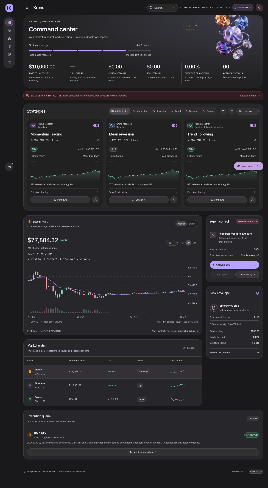

# Krono (AEGIS)

**An autonomous HSKSwap trading agent with conversational control and smart-contract-guarded execution on HashKey Chain.**

Built for the **HashKey Chain Horizon Hackathon · AI Agent Trading** track, Krono connects live V3 pool monitoring, on-chain analysis, arbitrage/spread detection, deterministic risk gates and automated execution in one auditable loop. Users inspect positions and P&L or change strategy through conversation. The original Krono interface, coin artwork and five-strategy library are preserved.

**Try it without keys:** `make setup && make demo`, then open [the AEGIS workspace](http://127.0.0.1:5173/#/aegis). The default uses **live mainnet data and virtual USDT**. Signed execution uses a separate, explicitly enabled gateway. Public deployment awaits distinct owner/agent addresses and funded local signers; [deployment evidence](docs/evidence/hsk-onchain-deployment.json) records that status without invented addresses or hashes.



## The track requirements, connected end to end

| Requirement                            | Implementation                                                                                                                                                                        | Judge-facing view                                                                               |
| -------------------------------------- | ------------------------------------------------------------------------------------------------------------------------------------------------------------------------------------- | ----------------------------------------------------------------------------------------------- |
| Real-time market monitoring            | [V3 connector](agent/aegis/connectors/hskswap_v3.py), [runtime](agent/aegis/runtime.py), [chain registry](config/networks.yaml)                                                       | AEGIS → Overview / Trading Desk: chain, block, prices and freshness                             |
| On-chain data analysis                 | [Verified pool reader](agent/aegis/data.py): `slot0`, `sqrtPriceX96`, tick, liquidity, fee tiers and code pins                                                                        | Closed-Loop Pipeline → **2. On-Chain Data Analysis**                                            |
| Arbitrage and price spreads            | [Closed-route arbitrage](agent/aegis/strategy/arbitrage.py), [reference spread analysis](agent/aegis/strategy/spreads.py), [original strategy bridge](backend/aegis_bridge.py)        | Trading Desk signals; Observatory records quote, spread and cost inputs                         |
| Autonomous execution                   | [Orchestrator](agent/aegis/service.py), [paper gateway](agent/aegis/execution/gateway.py), [signed gateway](agent/aegis/execution/live.py)                                            | Start paper agent → automatic checks/fills; execution ledger; separate signed CLI proof         |
| Strict risk and stop-loss              | [Risk policy](agent/aegis/risk/policy.py), [quote checks](agent/aegis/risk/engine.py), [Guard Vault](contracts/src/AegisVault.sol), [TWAP oracle](contracts/src/BandedTwapOracle.sol) | Risk Controls; position stops; PANIC; pipeline gate outcomes                                    |
| Conversational strategy control        | [Typed tools](agent/aegis/nl/tools.py), [AI controller](agent/aegis/nl/agent.py), [provider adapters](agent/aegis/nl/providers.py)                                                    | Assistant: USDT size, frequency, risk appetite, stop/take-profit, targets and active strategies |
| Real-time positions and P&L            | [Persistent ledger](agent/aegis/store/db.py), `get_portfolio_and_pnl()`                                                                                                               | Positions; realized/unrealized P&L; exposure; chat; stale values masked                         |
| Verifiable decisions and human control | [DecisionLog](contracts/src/DecisionLog.sol), [exact-byte verifier](agent/aegis/verify_decision.py), [Telegram](agent/aegis/nl/telegram_bot.py)                                       | Observatory pipeline, owner Wallet panel, human-confirmed close preview, mode/engine badges     |

## Closed-loop architecture

```mermaid
flowchart LR
    Human[Web chat / private Telegram] <--> AI[Conversational agent: typed tools]
    AI --> Config[Bounded live preferences]
    Config --> Runtime[Strategy orchestrator]
    Pools[Verified HSKSwap V3 pools] --> Monitor[Market monitor: chain / block / slot0]
    Monitor --> Analyze[On-chain prices / liquidity / fee tiers]
    Reference[Reference tickers + unchanged strategy library] --> Signals
    Analyze --> Signals[Arbitrage / spread / mean-reversion signals]
    Runtime --> Monitor
    Signals --> Risk[Deterministic risk + stop-loss gate]
    Risk --> Paper[Default: idempotent virtual fills]
    Risk --> Signed[Explicit signed gateway]
    Signed --> Log[Commit exact decision + action hash]
    Log --> Vault[Guard Vault + banded TWAP oracle]
    Vault --> Router[HSKSwap V3: output returns to vault]
    Router --> Reveal[Reconcile receipt + reveal unchanged bytes]
    Paper --> Ledger[SQLite positions / PnL / five-stage Observatory]
    Reveal --> Ledger
    Ledger --> Human
```



The AI translates intent and explains retrieved evidence. Deterministic signals and risk checks decide execution eligibility. A model cannot build raw transactions, receive keys, raise Guard caps or confirm its own close request. Provider failover is allowed only before any tool starts, preventing mutation replay. The pre-trade payload stays immutable; outcomes are separately reconciled against swap events.

## Run the judge demo

Requires **Python 3.12, uv and Node.js 22.12+**. Dependencies and contract tools stay project-local.

```bash
git clone https://github.com/vishal88736/automatic-trading-agent.git
cd automatic-trading-agent
make setup
make demo
```

Open **http://127.0.0.1:5173/#/aegis**; API: **http://127.0.0.1:8787**. Click **Refresh HSKSwap data**, inspect **Closed-Loop Pipeline & Risk Status**, then **Start paper agent**. Keep the terminal running. Ctrl+C stops it; backend source changes require a restart.

New ledgers have **100 virtual USDT** and start paused. The agent then checks markets at the configured interval without further clicks. Positions, fills, costs and preferences persist; restarting always pauses entries. PANIC latches a stop and requests bounded stable exits. Unavailable quotes leave an exit pending.

The chat chips exercise the track requirements:

- **Show my open positions and real-time P&L** — retrieves positions, virtual balances, P&L, win rate and risk state.
- **Set position size to 25 USDT and frequency to 30s** — one atomic update, bounded by NAV. On the initial ledger this is correctly refused by the **10% cap**; use **8 USDT and 45s** for an accepted example. Polling frequency never overrides the six-trades/hour ceiling.
- **Switch risk appetite to conservative with a 1.5% stop-loss** — applies the validated diff immediately.
- **Focus target assets on WHSK and WETH arbitrage spreads** — updates the target allowlist. Selection does not guarantee an opportunity.

Use **“explain latest decision”** for recorded pool inputs, calculations, risk outcomes and execution status. Close-all produces an expiring preview for the human to confirm. The six-item main navigation stays compact; Observatory, Wallet and setup tools remain under Settings.

### Why the agent may skip a trade

Native mean reversion needs 20 distinct-block observations. The original strategies require fresh reference prices and closed hourly candles. Liquidity, quote age, impact, costs, cooldown, exposure and loss limits can reject a signal.

The verified pool graph may have **no executable triangular cycle**; the scan records that result. QuoterV2 output already includes LP fees and price impact; net cycle math deducts modeled slippage and network cost once. A reference ticker versus an HSKSwap quote is useful lead-lag evidence, but lacks an executable second leg, verified reference fees and settlement/inventory costs. It is labeled **informational** and cannot independently authorize arbitrage execution.

## Conversational AI providers

Copy `.env.example` to ignored `.env`, configure providers and restart. No key is required for the bounded deterministic fallback.

| Provider                           | Local configuration                                                                                                      |
| ---------------------------------- | ------------------------------------------------------------------------------------------------------------------------ |
| Anthropic                          | `AEGIS_LLM_PROVIDER=anthropic`, `ANTHROPIC_API_KEY` (or `AEGIS_ANTHROPIC_API_KEY`), `AEGIS_ANTHROPIC_MODEL`              |
| OpenAI-compatible Chat Completions | `AEGIS_LLM_PROVIDER=openai`, `OPENAI_API_KEY` (or `AEGIS_OPENAI_API_KEY`), `AEGIS_OPENAI_MODEL`, `AEGIS_OPENAI_BASE_URL` |
| AWS Bedrock Converse               | `AEGIS_LLM_PROVIDER=bedrock`, `AEGIS_BEDROCK_MODEL`, `AEGIS_BEDROCK_REGION`, local AWS credentials / `AWS_PROFILE`       |
| Ordered failover                   | `AEGIS_LLM_FALLBACKS=openai,bedrock`, or opt-in `AEGIS_LLM_PROVIDER=auto`: configured Anthropic → OpenAI → Bedrock       |

Use an explicit tool-capable model available to your account. The badge distinguishes **Ready**, **Active (Tool-Calling)** after a tool runs, and **Deterministic Fallback**. Protocol tests cover adapters and failures; real delivery requires credentials. The compatible adapter uses named function tools and `max_completion_tokens`; endpoints must support that protocol. [OpenAI function calling](https://developers.openai.com/api/docs/guides/function-calling) and [Bedrock Converse](https://docs.aws.amazon.com/bedrock/latest/APIReference/API_runtime_Converse.html) document the formats.

Telegram is opt-in: configure the private chat, bot token and API bearer token, then run `make telegram` with those values loaded. [Connections](docs/CONNECTIONS.md) covers authentication and confirmation.

## Public deployment and on-chain verification

| Network     | Chain / RPC                         | GuardVault          | Oracle              | DecisionLog / proof |
| ----------- | ----------------------------------- | ------------------- | ------------------- | ------------------- |
| HSK testnet | **133** · `https://testnet.hsk.xyz` | Awaiting deployment | Awaiting deployment | No public tx yet    |
| HSK mainnet | **177** · `https://mainnet.hsk.xyz` | Awaiting deployment | Awaiting deployment | No public tx yet    |

[Deployment evidence JSON](docs/evidence/hsk-onchain-deployment.json) is the address/transaction source of truth. A successful runner populates direct Blockscout links for contracts and **commit → swap → reveal**. Network, explorer and token identities come from the [registry](config/networks.yaml) and [discovery](docs/DISCOVERY.md); testnet USDT has **18 decimals**, mainnet **6**. [Official network settings](https://docs.hskchain.net/docs/Build-on-HashKey-Chain/network-info) list current explorers.

### Signed, guarded mode

Use a device-held owner, a **different** agent and a separate funded deployer keystore. Owner keys never belong on this server. Use `.tools/foundry/cast` / `.tools/foundry/forge`; no global installation is needed.

```bash
make contracts-setup
make hsk-deployment-status

# Actual PUBLIC addresses and a funded local deployer account in this shell:
export AEGIS_OWNER_ADDRESS=0xYOUR_OWNER_PUBLIC_ADDRESS
export AEGIS_AGENT_ADDRESS=0xYOUR_DIFFERENT_AGENT_PUBLIC_ADDRESS
export AEGIS_DEPLOYER_ACCOUNT=hsk-deployer
make deploy-hsk-testnet ARGS='--broadcast'
```

For an encrypted keystore file, use `--keystore PATH --password-file PRIVATE_PATH` instead of an account alias. Keep password files private. Make targets inherit shell variables; to load `.env` use `uv run --frozen --no-sync --env-file .env python -m scripts.deploy_and_verify_hsk deploy --network testnet --broadcast`.

The runner prepares fresh oracle markets, deploys all three modules and binds the log. It checks canonical receipts, compiled runtime, ownership, module links and caps before writing **`deployments/133.json`**. Logs stay in ignored `.runtime/`. A broadcast marker blocks automatic redeployment after uncertainty; reconcile the existing artifact with `make record-deployment` first.

The owner then uses **Wallet → Review owner transaction** to deposit/wrap a small balance. For the default **0.005 WHSK** exit proof, deposit/wrap at least **0.1 HSK** to stay below the NAV cap. Fund the agent separately for gas. The vault may stay paused because bounded stable exits remain available.

```bash
# Unlock only the separate agent keystore locally; never send passwords to chat.
make prove-hsk-testnet ARGS='--broadcast --agent-keystore /PRIVATE/PATH/hsk-agent'

# Read-only verification after an actual reveal:
make verify-decision ARGS='--network testnet --decision-id ACTUAL_ID --reveal-tx ACTUAL_HASH'
```

The production gateway performs **three lifecycle transactions**: commit, guarded micro-swap, exact reveal, with journaled nonce handling and receipt reconciliation. A separate canonical `eth_call` must return the exact **`TradeLimit()`** selector for an oversized order; timeouts and unrelated reverts are rejected. This is deployed-bytecode limit enforcement, not a mined circuit-breaker transaction. The micro-swap is capped at **0.01 WHSK / 1 quoted USDT** and is an explicitly requested stable exit, not invented alpha.

Mainnet equivalents are `make deploy-hsk-mainnet` / `make prove-hsk-mainnet`, requiring **`--broadcast --i-understand-live`** after the owner authorizes capital. The web agent cannot enable signed mode. Compiled runtime verification is performed by the recorder; explorer source publication is separate. [Contract operations](docs/CONTRACTS.md) covers recovery, keepers and nonces.

Without public funds, `make verify-signed-fork` creates isolated dev accounts and verifies signed commit/swap/reveal, exact hashing, risk rejection and replay safety on a loopback testnet fork. Its hashes have **no public explorer receipts**.

## Strategies, risk and results

The five existing implementations and selector remain intact: **Momentum, Mean Reversion, Trend Following, Breakout, and Arbitrage Detection / spread research**. Their original configuration screens remain. The bridge maps **BTC → WBTC** and **ETH → WETH**; SOL has no verified HSKSwap mapping. Active-strategy preferences filter new entries without rewriting rules or disabling safety exits. Coinbase supplies reference candles; HSKSwap supplies independent executable quotes. SIMULATION and AEGIS PAPER ledgers remain separate.

Controls include a 10% per-trade NAV cap, exposure/position caps, six entries/hour, 20/day, cooldown, freshness, liquidity and impact checks, stop-loss, ATR stops, take-profit, optional trailing/time exits, 2% daily-loss and 10% drawdown stops. Signed execution fixes router, allowlisted path and vault recipient; only the immutable owner can withdraw to the owner. Independent keeper execution needs a funded process. [Risk](docs/RISK.md) and [security](SECURITY.md) state assumptions and exit constraints.

Paper accounting embeds quoted LP fees/impact, plus additional modeled slippage and network expense. Signed accounting reconciles receipts and output. **No sustained-profitability result is claimed.** Replay fills test behavior; fork swaps test integration. Neither establishes strategy performance or public execution. Historical evidence keeps its original revision and methodology; the earlier one-hour observation predates the current bridge.

## Validation and demo material

```bash
.venv/bin/python -m pytest backend/tests agent/tests legacy_tests/test_regime_detection.py legacy_tests/test_backtest_engine.py legacy_tests/test_portfolio_intelligence.py -q
.venv/bin/ruff check backend scripts agent
npm run build
make contracts-test
npm run test:e2e
.venv/bin/python -m scripts.production_smoke
```

[Current validation](docs/evidence/hackathon-upgrade-validation.json): **295 Python tests, 57 Solidity tests and 28 browser workflows**, plus ten Python subtests, Ruff, production build/restart and 19 optional platform tests. Opt-in live tests are reported separately. [Verification](docs/VERIFICATION.md) contains the 15-checkpoint audit: **13 verified within their stated local/read-only scopes; two public deployment/proof checkpoints blocked by missing actual wallet configuration and funds**. Provider protocol tests do not claim credential-backed delivery.

Also see the [three-minute demo](docs/DEMO_SCRIPT.md), [architecture](docs/ARCHITECTURE.md), [source/API index](docs/SOURCE_REFERENCE.md), [strategy rules](docs/STRATEGIES.md) and [connection guide](docs/CONNECTIONS.md). Retained research, backtests, news, legacy CLI/Dash and optional AWS tenant workspaces remain accessible without extra main navigation.

## Attribution

Krono extends the retained AlpacaTradingAgent/TradingAgents framework. Runtime code and notices remain; separate reference checkouts are unnecessary. See [LICENSE](LICENSE) and [THIRD_PARTY_NOTICES.md](THIRD_PARTY_NOTICES.md) for component-specific Apache-2.0, MIT and GPL notices.
