# Krono (AEGIS)

**Research, automate and verify HSKSwap trading on HashKey Chain.**

Built for the **HashKey Chain Horizon Hackathon · AI Agent Trading** track, Krono brings a crypto research workspace together with AEGIS: an autonomous market-monitoring, signal, risk and execution loop for HSKSwap. Users inspect positions and P&L, adjust strategies through conversation, and trace decisions from observed data to execution.

The original research home, coin artwork and strategy library remain available. The default AEGIS dashboard uses **live mainnet data with virtual funds in PAPER mode**. Its separate signed gateway has completed a **public HashKey testnet commit → guarded swap → reveal** lifecycle.

**Start without keys:** `make setup && make demo`. Open the [research home](http://127.0.0.1:5173/), then switch to [AEGIS · HSKSwap](http://127.0.0.1:5173/#/aegis).


## How it meets the AI Agent Trading track

| Requirement                             | Implementation                                                                                                                                                                   | Where to see it                                                                    |
| --------------------------------------- | -------------------------------------------------------------------------------------------------------------------------------------------------------------------------------- | ---------------------------------------------------------------------------------- |
| Real-time market monitoring             | [V3 connector](agent/aegis/connectors/hskswap_v3.py), [orchestrator](agent/aegis/service.py), [chain registry](config/networks.yaml)                                             | AEGIS Overview / Markets: chain, latest observed block, prices and freshness       |
| On-chain data analysis                  | [Verified reader](agent/aegis/data.py): slot0, sqrtPriceX96, tick, liquidity, fee tiers, token metadata and code pins                                                            | Closed-Loop Pipeline, stage 2                                                      |
| Arbitrage and price spreads             | [Closed-route scanner](agent/aegis/strategy/arbitrage.py), [reference-spread analysis](agent/aegis/strategy/spreads.py)                                                          | Signals and Observatory: routes, quotes, costs and skip reasons                    |
| Autonomous execution                    | [Paper runtime](agent/aegis/runtime.py), [paper gateway](agent/aegis/execution/gateway.py), [separate signed gateway](agent/aegis/execution/live.py)                             | Start paper agent; inspect reconciled fills; review the public testnet proof below |
| Strict risk and stop-loss               | [Risk policy](agent/aegis/risk/policy.py), [quote checks](agent/aegis/risk/engine.py), [Guard Vault](contracts/src/AegisVault.sol), [oracle](contracts/src/BandedTwapOracle.sol) | Risk Controls, position exits, PANIC and risk-gate outcomes                        |
| Conversational strategy and P&L control | [Validated tools](agent/aegis/nl/tools.py), [AI controller](agent/aegis/nl/agent.py), [persistent ledger](agent/aegis/store/db.py)                                               | Chat: positions, P&L, size, frequency, risk, target assets and active strategies   |
| Verifiable decisions and human control  | [DecisionLog](contracts/src/DecisionLog.sol), [exact-byte verifier](agent/aegis/verify_decision.py), confirmation previews                                                       | Public decision links, Observatory and owner Wallet panel                          |

## Start the project

Requires **Python 3.12, uv and Node.js 22.12+**. Setup installs locked dependencies into the project environment.

```bash
git clone https://github.com/vishal88736/automatic-trading-agent.git
cd automatic-trading-agent
make setup
make demo
```

The frontend runs at **http://127.0.0.1:5173** and the API at **http://127.0.0.1:8787**. `make demo` starts both. Keep the terminal running; Ctrl+C stops them. Restart after backend source or environment changes.

No wallet, gas or model API key is needed for the default paper workflow. To configure optional providers, copy `.env.example` to your local ignored `.env`; the launcher loads it. Saved **Settings → Data providers** take precedence after initial startup.

| Workspace             | Route                                  | Data and execution                                                                               |
| --------------------- | -------------------------------------- | ------------------------------------------------------------------------------------------------ |
| Research · simulation | `/`, `/#/strategies`, `/#/observatory` | Source-labeled reference markets/news, strategy research and a separate simulation account       |
| HSKSwap · AEGIS paper | `/#/aegis`                             | Live HashKey mainnet pool state and executable quotes; virtual funds and modeled execution costs |
| Signed public proof   | Explicit CLI, chain 133                | Real Guard Vault transactions on HashKey testnet; recorded below                                 |
| Signed mainnet        | Separate authorized deployment/CLI     | No registered mainnet deployment is claimed; requires explicit live acknowledgement              |

### Begin with the research website

The home page retains the coin artwork, market watch, price charts and strategy cards. Use **Strategy Lab** for configurations and available chronological backtests, **News Intelligence** for source-linked context, and **Agent Observatory** for recorded stages, signals and consolidated risk decisions.

Select an asset and use **Analyze BTC** (or the selected asset) to record a research cycle. Reference data carries its source and freshness state; backtests disclose fees, slippage and holdout assumptions. Optional bull/bear LLM research requires a configured provider. Unavailable or fixture data stays labeled.

In **Agent Observatory**, open **Read evidence report** for a structured brief of that cycle: calculated technical indicators, recorded news sources, optional model debate, rule agreement, requested/approved sizing, stop estimate, risk checks and execution state. Publisher links and timestamps are captured with new runs. Older runs that retained only news IDs explicitly show that citation gap. The browser checks the report's SHA-256 receipt against both the exact payload and the displayed data; this verifies **local snapshot integrity**.

**News Intelligence** supports search, asset/category filters, source details, latest/breaking feeds and manual refresh. Refresh failures keep cached stories marked stale and offer retry. A read-only check on **3 November 2026** returned three latest stories under the provider's free allowance and ten breaking stories. Allowances and availability are shown from the API response.

Use the **Execution workspace** selector to switch to **HSKSwap · AEGIS paper**. Research and AEGIS retain separate balances and ledgers. The [demo script](docs/DEMO_SCRIPT.md) opens with this research walkthrough before the HSKSwap flow.

### Start automatic HSKSwap trading

1. Open `/#/aegis` and click **Refresh HSKSwap data**.
2. Inspect the observed block, pool data, mode and **Closed-Loop Pipeline & Risk Status**.
3. Open **Strategies**, choose targets and entry strategies, and save preferences.
4. Click **Start paper agent**. The loop then monitors and evaluates at the configured interval without further clicks.
5. Inspect **Positions**, **Execution History** and **Agent Observatory** for fills, P&L and rejection reasons.

A new AEGIS ledger starts with **100 virtual USDT** and entries paused. Fills, holdings, preferences, position timers and risk baselines persist. Every restart pauses new entries; a latched emergency remains active until reviewed. PANIC blocks entries and requests bounded stable exits, subject to fresh quotes and risk checks.

### Inspect the executable market details

Open **AEGIS → Markets**, select WHSK, WETH or WBTC, and choose **Inspect executable routes**. The read-only inspector compares verified QuoterV2 routes for the current entry budget at a single observed block. It shows quoted output, the modeled paper fill floor, LP fees, price impact, gas units, expiry, target/pause state and quote preflight results. Expand a route for its exact token amounts, pool addresses, `sqrtPriceX96`, tick, liquidity and fee tiers. Expired quotes lose their quoted status; changing the asset or settings clears the prior inspection.

Quote inspection leaves balances, preferences, decisions and fills unchanged. LP fees are included once in QuoterV2 output. Additional paper slippage and the USDT network expense are labeled models; gas units alone are not an actual transaction fee. Portfolio, signal and execution gates retain their existing authority.

### Reference-inspired detail views

The structured research and market-detail patterns were informed by [Omega AI](https://github.com/ansu555/omega-ai-app/tree/88f843657cdfa73366263b8cd0ae394931e9930f). They are implemented independently in Krono's existing stack and screens:

| Reference pattern                           | Krono implementation                                                                                                        | Existing view                                     |
| ------------------------------------------- | --------------------------------------------------------------------------------------------------------------------------- | ------------------------------------------------- |
| Sourced research report and domain findings | [Recorded brief composer](backend/research_brief.py), captured news metadata and explicit evidence gaps                     | Research Agent Observatory → Read evidence report |
| Risk/allocation plan and decision receipt   | Recorded risk sizing, stop-loss estimate, execution state and browser-checked SHA-256 snapshot                              | The same evidence report                          |
| Detailed market and route comparison        | [Read-only quote inspector](agent/aegis/market_details.py), verified registry, exact V3 telemetry and expiring route quotes | AEGIS Markets → Pool price analysis               |

The research home and artwork, strategy library, adaptive controls, conversational tools, Telegram adapter, AWS workspace and signed Guard/DecisionLog flow remain available. Public-chain verification continues to use the separate contract evidence below.

Live-data captures: [research evidence report](docs/evidence/screenshots/research-brief-desktop.png) and [HSKSwap route details](docs/evidence/screenshots/hskswap-route-details-desktop.png).

## Conversational control and running-strategy changes

The same validated controls serve web chat and the optional private Telegram adapter. Example requests:

- **Show my open positions and real-time P&L.**
- **Set position size to 8 USDT and frequency to 45s.** On a fresh 100-USDT ledger this fits the reviewed 10% ceiling; lower NAV can require a smaller budget.
- **Switch risk appetite to conservative with a 1.5% stop-loss.**
- **Focus target assets on WHSK and WETH arbitrage spreads.**
- **Explain the latest decision.**
- **Pause**, **PANIC**, or **close all positions**. Closing produces a separate human-confirmed preview.

An out-of-range request such as **25 USDT on 100 USDT NAV** is refused. Risk presets apply bounded settings, and explicit values in the same request take precedence. Monitoring frequency does not override trade-frequency caps.

Running-strategy controls include:

- **Impact previews:** changes affecting existing holdings show the affected positions and require a one-use, expiring human confirmation.
- **Exit-rule scope:** apply reviewed exit changes to existing positions or retain their prior rules for new-entry-only changes.
- **Optional follow-up actions:** a confirmed change can request exits for removed targets or trim oversized holdings through the normal bounded gateway.
- **Settings history and rollback:** retained versions can be restored through the same validation and impact-review path.
- **Adaptive sizing:** optional risk-per-trade sizing and regime scaling can reduce the configured entry budget. NAV and absolute-USDT caps remain ceilings.
- **Guarded daily-loss trigger:** an optional threshold below the circuit breaker tightens settings toward the conservative preset.

Typed updates and their diffs are recorded in the local paper audit trail. These controls do not change on-chain Guard caps. Implementation: [runtime](agent/aegis/runtime.py), [policy](agent/aegis/risk/policy.py), [chat tools](agent/aegis/nl/tools.py) and [live-change tests](agent/tests/test_live_changes.py).

## Closed-loop architecture

```mermaid
flowchart LR
    Human[Web chat / private Telegram] <--> AI[Conversational agent: validated tools]
    AI --> Config[Versioned preferences / impact review]
    Config --> Runtime[Single-writer strategy orchestrator]
    Pools[Verified HSKSwap V3 pools] --> Monitor[Chain / block / slot0 monitor]
    Monitor --> Analyze[Prices / liquidity / fee tiers]
    Reference[Reference candles / configured strategy library] --> Signals
    Analyze --> Signals[Pool / route / reference signals]
    Runtime --> Monitor
    Signals --> Risk[Deterministic risk and stop-loss gate]
    Risk --> Paper[Default: idempotent virtual fills]
    Risk --> Signed[Separate explicitly authorized signer]
    Signed --> Log[Commit exact decision and action hash]
    Log --> Vault[Guard Vault / banded TWAP oracle]
    Vault --> Router[HSKSwap V3: recipient is the vault]
    Router --> Reveal[Reconcile confirmed receipt / reveal exact bytes]
    Paper --> Ledger[AEGIS SQLite positions / PnL / Observatory]
    Reveal --> Verify[Public receipt and payload verifier]
    Ledger --> Human
    Verify --> Human
```



The AI interprets intent and explains retrieved evidence. Deterministic calculations and risk checks decide execution eligibility. Models receive no wallet keys, cannot construct raw transactions or raise Guard caps, and cannot confirm their own close or settings previews. Provider fallback stops once a tool starts, preventing repeated mutations.

## Strategies, risk and accounting

The interface retains **seven entry selections**: two native HSKSwap strategies and the five-strategy research library. Their data sources and eligibility differ:

| Strategy                              | Input / execution boundary                                                                                                                                                    |
| ------------------------------------- | ----------------------------------------------------------------------------------------------------------------------------------------------------------------------------- |
| Pool mean reversion                   | Observed HSKSwap pool-price history; requires warmup and a cost-adjusted deviation                                                                                            |
| V3 arbitrage                          | Actual executable closed routes returning to the starting token; net output must cover costs                                                                                  |
| Momentum Trading                      | Reference-market EMA, MACD, RSI and volume rules; eligible mapped entries pass HSKSwap quote/risk checks                                                                      |
| Mean reversion                        | Reference-market Bollinger/RSI and range filters; the same guarded paper gateway                                                                                              |
| Trend Following                       | Reference-market EMA slope, trend and participation filters                                                                                                                   |
| Breakout Trading                      | Prior-window channel, ATR buffer and volume confirmation                                                                                                                      |
| Arbitrage Detection / spread research | Retained research evaluator; currently ineligible for standalone execution without compatible executable-route support. Native V3 scanning handles closed-route opportunities |

The [typed bridge](backend/aegis_bridge.py) maps **BTC → WBTC** and **ETH → WETH**. SOL remains available for research and has no verified HSKSwap execution mapping. A library entry must meet the research configuration, AEGIS selection, mapped target, source freshness and final quote/risk checks. A checked entry preference does not supply missing market data or make an unsupported route executable. [Strategy rules](docs/STRATEGIES.md) and [connection details](docs/STRATEGY_CONNECTION.md) describe these boundaries.

Reviewed paper ceilings include **10% NAV per fill**, **three concurrent holdings**, **30% aggregate exposure**, **six fills/hour**, **20/day** and a **30-second entry cooldown**. Stop-loss, take-profit, ATR, trailing and time exits complement the **2% daily-loss** and **10% drawdown** circuit breakers. Signed execution independently checks actual deployed limits; the owner can only tighten contract caps. See [risk semantics](docs/RISK.md).

QuoterV2 output already includes LP fees and tick-crossing impact. Paper fills add disclosed modeled slippage and network expense; those costs are not measured public gas fees. Signed execution reconciles actual receipts and credited output. Stale/RPC failures block fills and mask current valuation.

### Why no trade may occur

Pool mean reversion needs at least 20 distinct-block observations. Library strategies require fresh reference prices, sufficient closed hourly history and their configured entry/selection conditions. An executable arbitrage cycle may be absent or unprofitable after costs. Liquidity, impact, exposure, cooldown, loss limits, pause or emergency state can also block a fill. The Observatory records those reasons.

Reference-feed/DEX spreads remain informational without an executable second leg and complete settlement costs. The system does not force entries to make a demonstration move. Recorded paper round trips, replay fixtures and testnet exits establish behavior; **sustained profitability is not claimed**.

## Public HashKey testnet proof

The public registry records all three modules on **chain 133**:

| Contract         | Verified deployment                                                                                                                    |
| ---------------- | -------------------------------------------------------------------------------------------------------------------------------------- |
| AegisVault       | [0xE14185B7beFeeFF8ab241c3Ffae13bA7Ed61df5d](https://testnet-explorer.hskchain.net/address/0xE14185B7beFeeFF8ab241c3Ffae13bA7Ed61df5d) |
| BandedTwapOracle | [0x521C86fD6fe77Fee7493dC9e7242BBed271dE73f](https://testnet-explorer.hskchain.net/address/0x521C86fD6fe77Fee7493dC9e7242BBed271dE73f) |
| DecisionLog      | [0xA015aEAB0E97857b7eE322c7F7ee98AE98Cd9A30](https://testnet-explorer.hskchain.net/address/0xA015aEAB0E97857b7eE322c7F7ee98AE98Cd9A30) |

| Recorded decision                  | Commit                                                                                                                     | Guarded swap                                                                                                               | Reveal                                                                                                                     |
| ---------------------------------- | -------------------------------------------------------------------------------------------------------------------------- | -------------------------------------------------------------------------------------------------------------------------- | -------------------------------------------------------------------------------------------------------------------------- |
| **#1: stale-quote rejection**      | [0x6b72b4d8…](https://testnet-explorer.hskchain.net/tx/0x6b72b4d84d48f9dde5dc3b9e44ff4114fa8587ed2333a2a92b25c5a52fd9f77c) | Skipped; no swap transaction                                                                                               | [0x614e6ff7…](https://testnet-explorer.hskchain.net/tx/0x614e6ff788e6c5e70aa1201b3e1dd31815bb515b0d337cfc71c0d11b781835a8) |
| **#2: complete guarded lifecycle** | [0x2feb12ee…](https://testnet-explorer.hskchain.net/tx/0x2feb12eef781e1c261b93b29331bbc3fcc3715eeaf82c161519f790d05ac27ea) | [0x608bf335…](https://testnet-explorer.hskchain.net/tx/0x608bf3356bc586488b815b41d73bfad1db06c5c858517b27aaabf6b46f0a1a26) | [0x2a233028…](https://testnet-explorer.hskchain.net/tx/0x2a23302898edd33571f08f5759c4f3fc20fa529f4345a622188e603dff6adf93) |

Decision #1's quote was **57 seconds old** against a **20-second TTL**. The off-chain freshness gate rejected the swap; the on-chain reveal proves the exact unused commitment. Vault token balances were unchanged, while the agent paid commitment/reveal gas.

Decision #2 swapped **0.005 WHSK** into **0.270119936641739849 testnet USDT** and revealed **2,398 exact bytes**, with `consumed_by_vault: true` and `output_delta_raw: 0`. This is zero additional output delta against the recorded executable quote; its quoted fees and impact still apply. Receipt-reported lifecycle fees were **0.000695370676003869 HSK**. This was a bounded testnet stable exit.

[Deployment evidence](docs/evidence/hsk-onchain-deployment.json), [resume verification](docs/evidence/hsk-testnet-resume.json), and [deployments/133.json](deployments/133.json) retain the addresses, receipts, code pins and verification scope. A separate oversized-order `eth_call` checked the deployed `TradeLimit()` rejection; it was not a mined circuit-breaker transaction.

Verify the recorded decisions without unlocking a wallet or sending a transaction:

```bash
make verify-decision ARGS='--network testnet --decision-id 1 --reveal-tx 0x614e6ff788e6c5e70aa1201b3e1dd31815bb515b0d337cfc71c0d11b781835a8'
make verify-decision ARGS='--network testnet --decision-id 2 --reveal-tx 0x2a23302898edd33571f08f5759c4f3fc20fa529f4345a622188e603dff6adf93'
```

### Signed execution and deployment

The browser workflow remains PAPER. Signed execution uses a separate funded agent and an explicitly authorized CLI. The vault fixes the router, allowed assets and vault recipient; only the owner can withdraw to the owner. The owner key stays on the owner's device or in their local keystore.

The recorded proof is complete and needs no new deployment, deposit, wrap or swap. Recovery reuses the existing registry and signer journal. For deployment, recovery, source verification and keeper operation, follow [CONTRACTS.md](docs/CONTRACTS.md) and [CONNECTIONS.md](docs/CONNECTIONS.md).

Configured networks are **177 / `https://mainnet.hsk.xyz`** and **133 / `https://testnet.hsk.xyz`**. Verified token addresses and decimals come from [config/networks.yaml](config/networks.yaml); testnet USDT has 18 decimals and mainnet USDT has six. Testnet receipt verification stays on the pinned RPC and gives inconsistent node views a bounded reconciliation window. Project-local tools come from `make contracts-setup`.

Mainnet deployment and signing require separate owner authorization and **`--broadcast --i-understand-live`**. No public mainnet deployment or autonomous signed-entry scheduler is claimed. A local-fork run from `make verify-signed-fork` has local receipts and no public explorer transactions.

## AI providers and Telegram

Copy `.env.example` to ignored `.env`, configure the selected provider and restart:

| Provider               | Configuration                                                                                                                   |
| ---------------------- | ------------------------------------------------------------------------------------------------------------------------------- |
| Deterministic fallback | Default `AEGIS_LLM_PROVIDER=none`; no model key required                                                                        |
| Anthropic              | `AEGIS_LLM_PROVIDER=anthropic`, `ANTHROPIC_API_KEY` or `AEGIS_ANTHROPIC_API_KEY`, `AEGIS_ANTHROPIC_MODEL`                       |
| OpenAI-compatible      | `AEGIS_LLM_PROVIDER=openai`, `OPENAI_API_KEY` or `AEGIS_OPENAI_API_KEY`, `AEGIS_OPENAI_MODEL`, optional `AEGIS_OPENAI_BASE_URL` |
| AWS Bedrock            | `AEGIS_LLM_PROVIDER=bedrock`, `AEGIS_BEDROCK_MODEL`, `AEGIS_BEDROCK_REGION`, local AWS credentials/profile                      |
| Ordered fallback       | `AEGIS_LLM_FALLBACKS=openai,bedrock`, or opt-in `AEGIS_LLM_PROVIDER=auto`                                                       |

Use a tool-capable model available to your account. The UI distinguishes readiness, **Active (Tool-Calling)** after successful tool use, and **Deterministic Fallback**. A provider failure after a tool starts retains the tool result and does not replay the mutation. Actual model entitlement and external delivery require credentials.

Telegram is opt-in: configure `AEGIS_TELEGRAM_BOT_TOKEN`, the owner's private `AEGIS_TELEGRAM_CHAT_ID`, `TERMINAL_API_TOKEN` and `AEGIS_API_URL`, then run `make telegram` with those variables loaded. The adapter uses the same authenticated paper API and human-confirmation boundary. Never put wallet keys or passwords in chat.

## Technology

| Layer                  | Stack                                                                               |
| ---------------------- | ----------------------------------------------------------------------------------- |
| Interface              | React, TypeScript, Vite, source-labeled charts and shared workspace state           |
| Backend and research   | Python 3.12, FastAPI, Pydantic, SQLite, pandas and LangGraph                        |
| Chain integration      | Web3.py, EVM JSON-RPC and HSKSwap V3 / QuoterV2                                     |
| Contracts              | Solidity, Foundry and OpenZeppelin                                                  |
| Conversational control | Anthropic / OpenAI-compatible / Bedrock adapters and a bounded deterministic router |
| Quality checks         | Pytest, Playwright, Ruff, strict TypeScript and Guard tests                         |

Research, HSKSwap paper and the optional AWS tenant platform use separate execution contexts. The retained AWS setup is documented in [AWS_SETUP.md](docs/AWS_SETUP.md).

## Validation and submission material

The **3 November 2026** validation of this working tree (base **`4987d73`**) passed **405 Python tests plus 10 subtests**, **38 browser tests**, Ruff and the frontend production build. The Guard suite has **57 passing Solidity tests**. The normal Python suite skips one explicitly opt-in live connector test; the Solidity suite skips its opt-in live-fork test. See the scoped [frontend/reference validation](docs/evidence/frontend-reference-validation.json).

Separate live checks verified source-backed research/news in the browser and read-only mainnet quotes for **WHSK, WETH and WBTC**. Each asset inspection used one pinned block, returned actual pool telemetry and passed quote preflight. These checks used isolated virtual ledgers, invoked no models and sent **zero transactions**. They do not refresh the historical public testnet receipts or establish profitability.

```bash
.venv/bin/python -m pytest backend/tests agent/tests legacy_tests/test_regime_detection.py legacy_tests/test_backtest_engine.py legacy_tests/test_portfolio_intelligence.py -q
.venv/bin/ruff check backend scripts agent
.venv/bin/ruff format --check backend scripts agent
.venv/bin/python -m scripts.generate_code_reference --check
npm run build
make contracts-test
npm run test:e2e
.venv/bin/python -m scripts.production_smoke
.venv/bin/python -m scripts.public_audit
```

Browser tests use an isolated, labeled fixture API. Explicit network checks and signed fork checks are opt-in; [VERIFICATION.md](docs/VERIFICATION.md) documents their scope. The earlier [submission report](docs/evidence/hackathon-upgrade-validation.json) records **15/15 checkpoints passed within that report's stated scopes**. Its test totals, browser captures and earlier soak belong to their recorded revisions.

- [Demo script and pitch](docs/DEMO_SCRIPT.md): research website first, followed by AEGIS and public proof.
- [Architecture](docs/ARCHITECTURE.md) and [source/API reference](docs/SOURCE_REFERENCE.md).
- [Strategy rules](docs/STRATEGIES.md), [risk semantics](docs/RISK.md) and [security/threat model](SECURITY.md).
- [Discovery](docs/DISCOVERY.md), [contract operations](docs/CONTRACTS.md) and [connection setup](docs/CONNECTIONS.md).

## Attribution

Krono extends the retained AlpacaTradingAgent/TradingAgents framework. Runtime code and notices remain; separate reference checkouts are unnecessary. [LICENSE](LICENSE) and [THIRD_PARTY_NOTICES.md](THIRD_PARTY_NOTICES.md) retain the component-specific Apache-2.0, MIT and GPL notices.

[Omega AI](https://github.com/ansu555/omega-ai-app) informed the added research-brief, decision-receipt and executable-route presentation patterns; the adaptations are described above.
