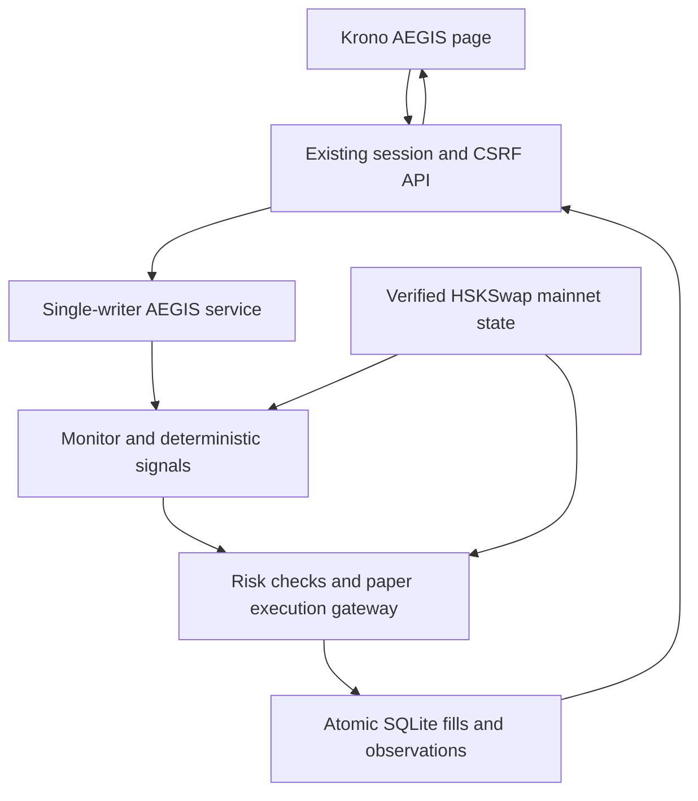

# Connected AEGIS paper flow

AEGIS is available inside the existing Krono React application at `/#/aegis`. This page reads an authenticated FastAPI service backed by the actual AEGIS ledger and connector. It uses live mainnet pool data and virtual balances; it cannot sign or submit public transactions. Existing Krono simulation and AWS tenant agents remain separate runtimes and ledgers.

## Start and inspect

```bash
make setup
make demo
```

Open `http://127.0.0.1:5173/#/aegis`. Press **Refresh HSKSwap data**, inspect the observed block and three pools, then explicitly start the paper agent. Initial virtual cash is 100 USDT. Restarting preserves funding, fills, preferences, holding times and risk baselines; new entries recover paused. An emergency remains latched across restart.

Twenty distinct observed blocks are required before a mean-reversion entry. The signal compares a rolling pool-price mean with the current price, requires a sufficiently negative z-score and deducts modeled round-trip costs. No entry is forced for a demo. Closed-route arbitrage evaluates net Quoter output after fees, modeled slippage and network costs; discovery has not found a liquid registered mainnet triangle. No CEX spread is presented as an executed two-leg arbitrage.

## One state, one execution gate



SQLite and synchronous RPC calls run on one dedicated thread. Browser polling reads cached state and cannot create a trade. A gateway rechecks original intent, quote/block freshness, liquidity, price impact, balance, portfolio sizing and control flags. Fills use durable idempotency keys. LP fees are embedded in Quoter output, extra modeled slippage reduces received tokens, and the modeled network expense is deducted once from virtual USDT.

The position size default is 5% with a reviewed 10% ceiling; the off-chain portfolio exposure cap is conservatively 30% in total. Other gates include three positions, six fills per UTC hour, twenty per UTC day and a 30-second entry cooldown. Stop-loss, take-profit, trailing and holding-time exits run before new entries. Daily loss of 2% or observed drawdown of 10% latches entry pause and requests a stable unwind. These software rules complement rather than replace the contract controls used by future live execution.

## Controls and failure behavior

- **Pause entries** leaves monitoring and risk-reducing exits available. No new entry is accepted after its control acknowledgement.
- **PANIC** latches the emergency flag and requests bounded exits into virtual USDT. Fresh quotes, minimum outputs and per-trade limits still apply. Quote failure leaves the unwind pending and visible.
- **Close all** first returns an expiring preview bound to the current holdings. Confirmation is one-use; changed holdings require another preview.
- **Clear stop** requires fresh marks and a completed stable unwind. It leaves entries paused; resuming is a separate action.
- RPC errors preserve the ledger and expose unavailable valuation. Stale marks are never shown as current NAV. They do not trigger an estimated-price fallback fill.
- Strategy preferences are schema-validated and versioned. Out-of-range, unsupported and prompt-injection requests cannot loosen caps or access keys.

The local natural-language control plane is an explicitly labeled deterministic router, with typed tools for status, positions, P&L, recent decisions, preferences, pause/resume, confirmed close and trade explanation. It does not claim that a model was invoked. Raw messages stay in browser memory; typed control changes and tool events are recorded. Public commit/reveal badges remain unavailable until real deployed contracts and receipts are registered.

## HTTP boundary

| Method | Route | Behavior |
| --- | --- | --- |
| GET | `/api/aegis/state` | Cached mode, freshness, positions, P&L, policy, fills and local decisions |
| POST | `/api/aegis/check` | One verified market observation and eligible strategy/stop evaluation |
| PUT | `/api/aegis/settings` | Validated patch with `expected_version` |
| POST | `/api/aegis/control` | Explicit paper controls and close confirmation |
| POST | `/api/aegis/chat` | Shared validated language tools |

All routes use the existing session/CSRF or bearer boundary. The terminal-wide emergency stop also latches AEGIS. Browser-test connector injection is restricted to an explicit isolated test application; normal startup never selects fixtures for AEGIS.

## Checks and external boundaries

`agent/tests/test_runtime.py` exercises autonomous entry, rejected risk, pause during quote, stop-loss replay, emergency recovery, one-use close confirmation and persistence. `backend/tests/test_aegis_api.py` tests the authenticated HTTP path. `e2e/aegis.spec.ts` tests the actual API through desktop/mobile UI, including rejected controls and unavailable-service recovery. The isolated browser connector is visibly labeled `TEST_FIXTURE`.

`python -m scripts.verify_aegis_flow --i-understand-paper --duration-seconds 3600` runs a separate real-mainnet-data HTTP check and one-hour unattended paper observation. It records a forced round trip separately from strategy performance, checks the shared ledger and language bounds, then verifies restart recovery. Evidence and screenshots are produced under ignored `artifacts/`; an in-progress run is not a passed acceptance result.

The user-supplied `kavach-main/` folder is retained as an ignored local reference and excluded from deployment contexts. No owner key is required for this paper flow. Actual public deployment, funding and external model/Telegram delivery still require their respective configuration and evidence.
