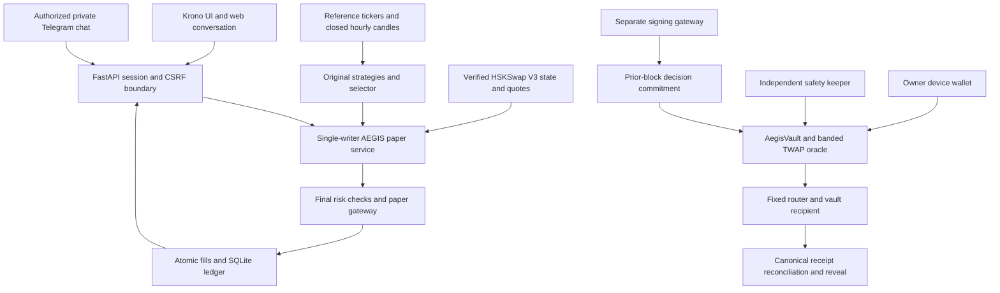

# Architecture

Krono's React shell preserves the original coin artwork, visual theme and strategy library. Six core navigation items keep trading controls prominent; secondary tools live in Settings. The original research simulator, HSKSwap paper agent and optional AWS tenant platform have distinct execution contexts and ledgers.

## Local runtime

`backend/api.py` authenticates requests, checks origin/CSRF and validates typed input. Decimal financial values and on-chain audit integers serialize as strings. The UI and optional Telegram bridge share bounded portfolio/P&L, strategy-update, latest-decision, panic and close-preview tools. Anthropic, OpenAI-compatible and Bedrock adapters normalize provider requests into that same control agent. Failover stops once any tool starts. Models cannot receive keys, build transactions or confirm their own close previews. Engine badges distinguish configured readiness, actual tool use and deterministic fallback.

`backend/aegis_bridge.py` reuses the original strategy rules and selector with fresh reference-market inputs. BTC/ETH map to verified WBTC/WETH; SOL is blocked. `agent/aegis/runtime.py` combines those signals with native pool mean reversion and closed-route scanning. Signal presence never bypasses risk, quote, control or liquidity checks. See [strategy connection](STRATEGY_CONNECTION.md).

One dedicated thread owns synchronous RPC and the AEGIS SQLite connection. Browser polling only reads cached state. Fills and strategy origin are stored atomically; restart retains balances, ATR stops, configuration and risk baselines, with entries paused. Emergency stops remain latched. Pause blocks entries while fresh-data risk exits continue. See [paper flow](AEGIS_FLOWS.md) and [risk semantics](RISK.md).

## Research and existing features

`backend/engine.py` retains the LangGraph research/simulation workflow. Reference market/news ingestion validates timestamps and history, caches bounded responses and reports stale/unavailable data. Optional bull/bear researchers and trader consolidation remain advisory; an unconfigured model is explicitly skipped.

Research simulation uses risk-approved previews, human authorization, unique intents and atomic accounting. Positions, backtests, alerts, news and charts use their recorded source and execution context. The five strategy implementations are unchanged. Its capital account is separate from HSKSwap paper funds.

The optional AWS platform uses Cognito, tenant-aware storage and isolated simulation workers; it does not accept HSKSwap trading keys or run the AEGIS paper ledger. Its setup, deployment boundaries and account-level checks are documented in [AWS setup](AWS_SETUP.md).

## On-chain boundary

`AegisVault`, `BandedTwapOracle` and `DecisionLog` enforce bounded authority and exact committed actions. Owner operations are prepared by the backend and signed on the owner's device. Swap recipients remain the vault. The separate signer journals nonces/intents, simulates the committed action and reconciles canonical confirmed receipts and balances. The keeper can execute only contract-triggered safety exits.

Signed commit/swap/reveal execution is verified on both a local HashKey fork and public HashKey testnet (133). The public registry contains all three deployed modules. Decision #1 reveals an unused stale-quote commitment; decision #2 completes a bounded 0.005 WHSK swap with matching vault balance deltas and a 2,398-byte exact reveal. Paper feed items remain local; public verification badges require the matching registered chain/contracts and confirmed reveal receipts. These testnet receipts do not turn paper records into on-chain decisions. See [contracts and public decision tables](CONTRACTS.md), [discovery](DISCOVERY.md) and [security](../SECURITY.md).

## Source and operational map

[Development](DEVELOPMENT.md) lists module responsibilities, configuration and entry points. The generated [API/source index](SOURCE_REFERENCE.md) links active routes and symbols. [Verification](VERIFICATION.md) separates replay, live-data, local-fork and public evidence. Attribution and inherited-file adaptations are recorded in [third-party notices](../THIRD_PARTY_NOTICES.md).
